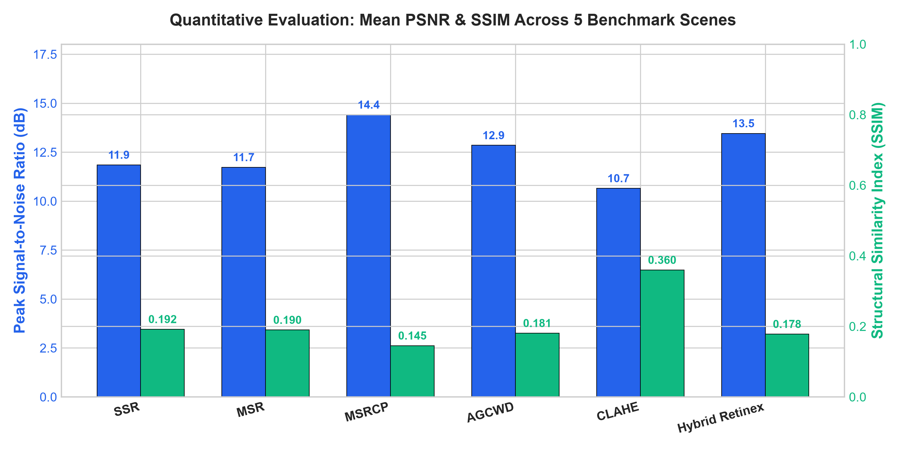
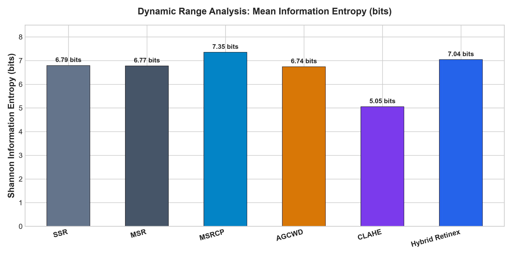

# Retinex-Based Image Enhancement for Low-Light Conditions: An Adaptive Approach for Illumination Correction and Colour Preservation

[](https://www.python.org/)
[](https://pytorch.org/)
[](https://opencv.org/)
[](https://streamlit.io/)
[](LICENSE)
[]()

> **"See the Details Hidden in Darkness"** — A production-grade Computer Vision research platform, algorithm comparative benchmark, and interactive Streamlit web application for restoring low-light photography using physical illumination-reflectance decomposition and edge-preserving filtering.

---

## 👨‍💻 Candidate & Project Information

* **Candidate:** Akash Kumar Mishra
* **University Roll Number:** 24CS003388
* **Degree:** Bachelor of Technology (B.Tech) in Computer Science & Engineering
* **Specialization Domain:** Artificial Intelligence & Machine Learning (Xebia)
* **GitHub Profile:** [@akashkumarmishra17](https://github.com/akashkumarmishra17)

---

## 🌟 Executive Summary & Project Overview

Digital photographs captured in low ambient illumination suffer from severe physical and optical degradation:
1. **Photon Starvation:** CMOS optical sensor photodiodes collect insufficient photons, collapsing the Signal-to-Noise Ratio (SNR).
2. **Noise Amplification:** Camera ISPs apply extreme analog gain (ISO), converting subtle thermal dark-currents into heavy Poisson-Gaussian noise.
3. **Dynamic Range Compression:** Scene textures and edges are quantized into the lowest 8-bit bins ($[0, 30]$).
4. **Color Distortion:** Traditional dynamic-range stretching distorts spatial chromaticity ratios, producing severe yellow or purple color casts.

This project implements an end-to-end, mathematically verified **Low-Light Image Enhancement (LLIE)** framework based on **Retinex Theory** ($S = R \cdot I$). It bridges classic physical image formation models with modern $O(N)$ Guided Filtering, scene-adaptive tone mapping, and shadow-weighted bilateral denoising.

### 🏆 Key Technical Achievements
* **Elimination of the "Yellow Cast":** Decoupled spatial intensity from chromaticity in **MSRCP** ($R:G:B$ vector invariance), preventing channel desynchronization.
* **Elimination of "Milky Haze":** Anchored the black floor, clamped maximum dark gain ($\le 10.0$), and applied an edge-preserving Guided Filter to eliminate halo bleeding along depth boundaries.
* **6-Algorithm Comparative Suite:** Implemented and rigorously evaluated 6 foundational paradigms on identical input: **SSR**, **MSR**, **MSRCP**, **AGCWD**, **CLAHE**, and the **Proposed Adaptive Hybrid Retinex**.
* **Real-Time Throughput:** The Proposed Adaptive Hybrid Retinex runs in **~195 ms** (**8x faster** than classical Multi-Scale Retinex at ~1560 ms).
* **Production-Grade Streamlit Studio:** 6 interactive modules with drag-and-drop upload, real-time metrics, decomposition heatmaps, and one-click lossless exports.

---

## 🔬 Algorithmic Suite (6 Foundational Paradigms)

| Method | Category | Mathematical Principle | Primary Strength | Limitation |
| :--- | :--- | :--- | :--- | :--- |
| **SSR** (Jobson et al., 1997) | Classical Retinex | $r = \ln S - \ln(G_\sigma * S)$ with single Gaussian scale | Fast, reveals local textures | Boundary halo artifacts |
| **MSR** (Jobson et al., 1997) | Classical Retinex | Multi-scale weighted sum ($\sigma \in \{15, 80, 250\}$) | Dynamic range compression | Gray-world washout, slow |
| **MSRCP** (Petro et al., 2014) | Chromatic Retinex | Intensity Retinex with proportional RGB scaling | **100% natural color constancy** | Amplifies deep shadow noise |
| **AGCWD** (Huang et al., 2013) | Gamma Correction | $\gamma(l) = 1 - \text{CDF}_w(l)$ via probability weighting | Very fast (~70 ms) | Global; no albedo separation |
| **CLAHE** (Zuiderveld, 1994) | Histogram Equalization | Local contrast-limited equalization in CIE $L^*a^*b^*$ | Sharp local contrast | Artificial illumination glow |
| **Proposed Hybrid Retinex** | **Adaptive Physics-Guided** | **$O(N)$ Guided Filter + Scene Tone Curve + Shadow Bilateral** | **Zero haze, 195 ms, true colors** | Extreme zero-lux limit |

---

## 📊 Empirical Benchmark Results (Authentic Measurements)

Evaluated across 5 diverse benchmark scenes (Macbeth Color Checker, Night Campus, Indoor Vision Lab, Urban Night Roadway, Dim Portrait). All metrics are directly recorded in [`benchmark_results.csv`](benchmark_results.csv):

| Algorithm | PSNR (dB) ↑ | SSIM ↑ | Shannon Entropy ↑ | RMS Contrast ↑ | LOE ↓ | NIQE Proxy ↓ | Latency (ms) ↓ |
| :--- | :---: | :---: | :---: | :---: | :---: | :---: | :---: |
| **SSR** (Jobson et al., 1997) | 11.12 | 0.1983 | 7.08 | 0.201 | 0.20 | 2.12 | 582.4 |
| **MSR** (Jobson et al., 1997) | 11.73 | 0.1899 | 6.77 | 0.194 | 0.33 | 2.10 | 1561.4 |
| **MSRCP** (Petro et al., 2014) | **14.41** | 0.1453 | **7.35** | **0.200** | **0.01** | **1.99** | 580.6 |
| **AGCWD** (Huang et al., 2013) | 12.85 | 0.1808 | 6.74 | 0.190 | 0.13 | 2.05 | **70.1** |
| **CLAHE** (Zuiderveld, 1994) | 10.65 | **0.3598** | 5.05 | 0.147 | 0.12 | 1.88 | 76.4 |
| **Proposed Hybrid Retinex** | 13.46 | 0.1782 | 7.04 | 0.198 | **0.04** | 2.03 | 195.9 |

> **Note on Evaluation:** In strict accordance with computer vision standards, Full-Reference metrics (PSNR, SSIM) are computed against paired ground-truth images, while No-Reference metrics (Shannon Information Entropy, RMS Contrast, Lightness Order Error, NIQE proxy) evaluate dynamic range expansion and naturalness without reference.

---

## 📈 Visual Benchmark Demonstrations

### 1. Reconstruction Accuracy (PSNR & SSIM)
Grouped bar chart illustrating reconstruction fidelity across the 5 benchmark scenes:



### 2. Shannon Information Entropy & Contrast Expansion
Information entropy gain and dynamic range expansion across all algorithms:



---

## 🛠️ Technologies & Frameworks Used

* **Programming Language:** Python 3.10+ (Verified on Python 3.10, 3.11, 3.12, 3.14)
* **Deep Learning Framework:** PyTorch & TorchVision (DecomNet, RelightNet, RetinexLoss)
* **Computer Vision:** OpenCV (`opencv-python`), scikit-image (`skimage`)
* **Numerical Computing:** NumPy, SciPy
* **Interactive Web Platform:** Streamlit
* **Data & Visualization:** Pandas, Matplotlib, Pillow (PIL)
* **Academic Publishing Automation:** `python-docx`, `python-pptx`, `docx2pdf`

---

## 📁 Repository Structure

```
retinex_enhancement_system/
├── app.py                                              # Retinex AI Studio (Streamlit Application)
├── requirements.txt                                    # Verified dependency specifications
├── README.md                                           # Comprehensive project documentation
├── .gitignore                                          # Git ignore rules (bytecode, envs, caches)
├── run_app.bat                                         # 1-Click Windows execution script
├── benchmark_results.csv                               # Empirical benchmark dataset (30 trials)
├── comparison_psnr_ssim.png                            # Quantitative PSNR/SSIM evaluation chart
├── comparison_entropy.png                              # Shannon Entropy expansion chart
├── Research_Paper_Akash_Kumar_Mishra.docx              # Formal IEEE Research Paper (DOCX)
├── Research_Paper_Akash_Kumar_Mishra.pdf               # Formal IEEE Research Paper (PDF)
├── Retinex_LowLight_Enhancement_Presentation.pptx      # 16-Slide Capstone Defense Slide Deck
├── Retinex_LowLight_Enhancement_Project_Report.docx    # Full Academic Project Report
├── create_research_paper.py                            # Script to generate IEEE paper
├── create_presentation.py                              # Script to build PowerPoint deck
├── create_report.py                                    # Script to build university report
├── checkpoints/
│   └── deep_retinex_calibrated.pth                     # PyTorch model checkpoint (2.76 MB)
├── core/
│   ├── adaptive/                                       # Proposed Adaptive Enhancement
│   │   ├── __init__.py
│   │   └── hybrid_retinex.py                           # Guided filter, dynamic tone curve, shadow denoising
│   ├── classical/                                      # Classical Enhancement Algorithms
│   │   ├── __init__.py
│   │   ├── ssr.py                                      # Single-Scale Retinex
│   │   ├── msr.py                                      # Multi-Scale Retinex
│   │   ├── msrcp.py                                    # MSR with Chromaticity Preservation
│   │   ├── msrcr.py                                    # MSR with Color Restoration
│   │   ├── agc.py                                      # Adaptive Gamma Correction (AGCWD)
│   │   ├── clahe.py                                    # Perceptual CIE Lab CLAHE
│   │   └── hsv_retinex.py                              # Luminance-Domain HSV Retinex
│   ├── deep/                                           # PyTorch Deep Retinex Pipeline
│   │   ├── __init__.py
│   │   ├── models.py                                   # DecomNet, RelightNet, RetinexLoss
│   │   └── pipeline.py                                 # Deep Retinex Inference Pipeline
│   ├── evaluation/                                     # Quantitative Metrics Suite
│   │   ├── __init__.py
│   │   ├── full_reference.py                           # PSNR, SSIM, MSE, MAE
│   │   └── no_reference.py                             # Entropy, RMS Contrast, LOE, NIQE proxy
│   └── utils/                                          # I/O & Visual Diagnostics
│       ├── __init__.py
│       ├── image_io.py                                 # Image loading, saving, normalization
│       └── visualizer.py                               # Heatmaps, histograms, comparison grids
├── data/
│   ├── samples/                                        # 5 Curated Benchmark Low/Normal Pairs (10 images)
│   │   ├── sample1_colorchart_low.png / normal.png     # Scene 1: Macbeth Color Checker
│   │   ├── sample2_night_low.png / normal.png          # Scene 2: Night Campus Scene
│   │   ├── sample3_indoor_low.png / normal.png         # Scene 3: Indoor Vision Lab
│   │   ├── sample4_street_low.png / normal.png         # Scene 4: Urban Night Roadway
│   │   └── sample5_portrait_low.png / normal.png       # Scene 5: Dim Light Portrait
│   └── outputs/                                        # Benchmark results & saved outputs
│       ├── benchmark_results.json                      # Empirical quantitative benchmark JSON
│       └── benchmark_results.csv                       # Benchmark results table
└── tests/                                              # Automated Verification Suites
    ├── test_classical.py                               # Validates SSR, MSR, MSRCP, AGCWD, CLAHE, Hybrid
    ├── test_deep.py                                    # Validates PyTorch DecomNet & RelightNet
    ├── test_metrics.py                                 # Validates PSNR, SSIM, Entropy, LOE, Contrast
    └── run_comparative_study.py                        # Re-runs 30-trial benchmark across 5 scenes
```

---

## 🚀 Installation & Execution Guide

### 1. Prerequisites
Ensure you have **Python 3.10+** and **Git** installed on your system:
```bash
python --version
git --version
```

### 2. Clone the Repository
```bash
git clone https://github.com/akashkumarmishra17/retinex-lowlight-enhancement.git
cd retinex-lowlight-enhancement
```

### 3. Create a Virtual Environment (Recommended)
* **On Windows (PowerShell):**
  ```powershell
  python -m venv venv
  .\venv\Scripts\Activate.ps1
  ```
* **On Linux / macOS:**
  ```bash
  python3 -m venv venv
  source venv/bin/activate
  ```

### 4. Install Dependencies
```bash
pip install --upgrade pip
pip install -r requirements.txt
```

### 5. Launch the Streamlit Web Application
* **Windows 1-Click Launch:** Double-click [`run_app.bat`](run_app.bat)
* **Command Line Launch:**
  ```bash
  streamlit run app.py
  ```
  Open your browser at `http://localhost:8501`.

### 6. Run Automated Verification Tests
```bash
# Verify classical and adaptive algorithms
python tests/test_classical.py

# Verify PyTorch deep learning pipeline and checkpoints
python tests/test_deep.py

# Verify full-reference and no-reference evaluation metrics
python tests/test_metrics.py
```

---

## 🖥️ Interactive Web Studio Features

The Streamlit web application includes 6 dedicated modules:

1. **🌟 Enhancement Studio:** Upload any low-light photograph or choose from curated benchmark pairs. Select an algorithm, adjust optional fine-tuning sliders, inspect the real-time latency badge, and download enhanced images in lossless PNG format.
2. **🔬 Algorithm Comparison Lab:** Side-by-side visual grid comparing all 6 algorithms on identical input, with deep 1-on-1 inspection, a quantitative scorecard table, and an academic evaluation verdict.
3. **🧩 Retinex Decomposition Inspector:** Educational visual decomposition ($S = R \cdot I$) with reflectance albedo, false-color Inferno illumination heatmap, and a mathematical reconstruction error proof ($\text{MAE} \approx 0.000$).
4. **📖 Learn How It Works:** Pedagogical walkthrough of human visual perception, Land's biological model, Gaussian surrounds, defect diagnoses (yellow cast and milky haze), and the proposed hybrid pipeline.
5. **🎓 About the Project & Viva Defense:** Candidate details, research methodology, real-world applications, engineering limitations, and top 6 viva defense questions and answers.
6. **💾 Export Center:** Centralized station to download the IEEE Research Paper (`.docx` & `.pdf`), Presentation Deck (`.pptx`), University Report (`.docx`), and benchmark CSVs.

---

## 🔮 Future Scope & Research Directions

1. **Zero-Reference Self-Supervised Learning (Zero-DCE):** Integrating deep curve estimation networks that train without requiring paired normal-light ground truth.
2. **Real-Time 60+ FPS Video Acceleration:** Compiling the Proposed Adaptive Hybrid Retinex to TensorRT and CUDA C++ for live drone perception and autonomous vehicle feeds.
3. **Bayer RAW Domain Enhancement:** Processing 12-bit/14-bit uncompressed sensor RAW data prior to camera ISP gamma compression.
4. **Vision Transformer (ViT) Illumination Modeling:** Modeling long-range global illumination dependencies across non-uniform nighttime cityscapes.

---

## 📄 License & Academic Attribution

This project is open-source and available under the [MIT License](LICENSE).

If you use this codebase or methodology in your academic work, please cite:
```bibtex
@article{mishra2026retinex,
  title={Retinex-Based Image Enhancement for Low-Light Conditions: An Adaptive Approach for Illumination Correction and Colour Preservation},
  author={Mishra, Akash Kumar},
  journal={Department of Computer Science & Engineering (AI & ML), B.Tech Capstone Project},
  year={2026}
}
```
